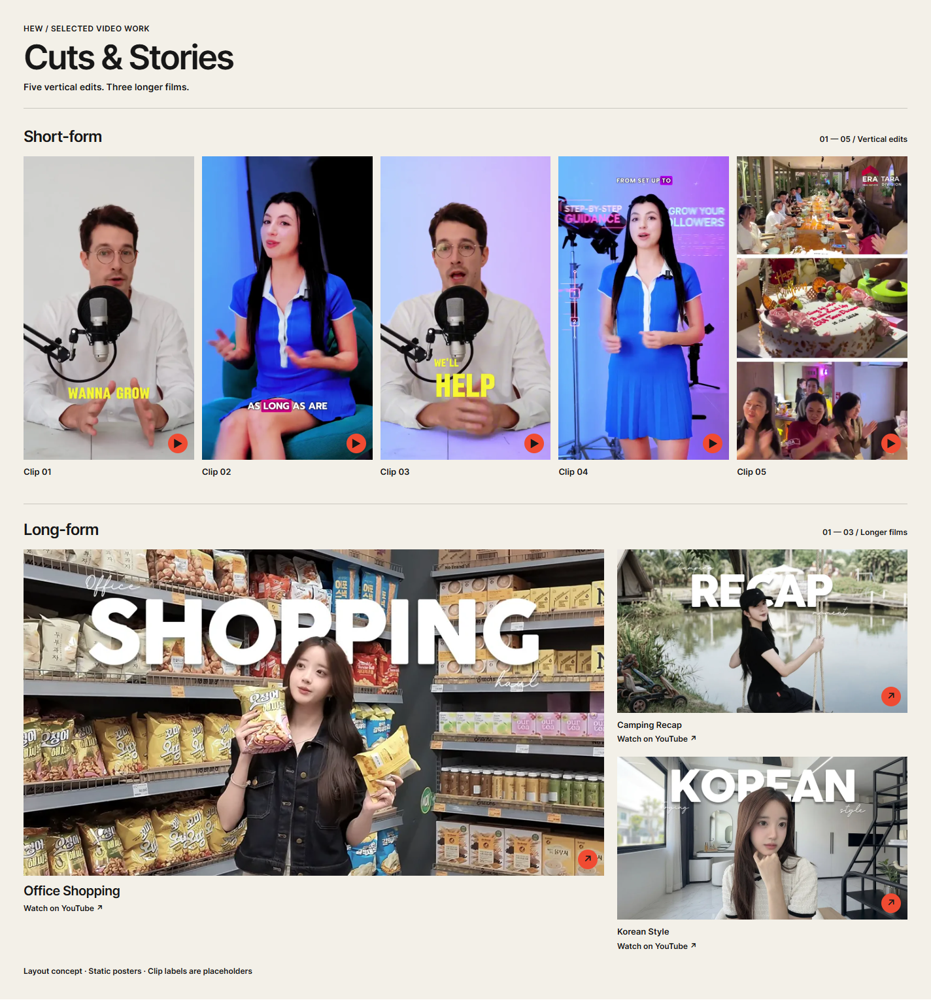

# Kế hoạch chỉnh sửa layout — Cuts & Stories

Ngày lập: 10/10/2026  
Dự án: Trung Hau / HEW  
Trang áp dụng: `/work/short-form`  
Trạng thái: tài liệu đề xuất và hướng dẫn thực hiện; chưa sửa website.

> **Lưu ý bắt buộc:** “đối chiếu phần cần chỉnh sửa và code hiện tại để tránh mâu thuẫn trong quá trình thực hiện. Kiểm tra, chạy test trước khi bàn giao kết quả”.

## Phần 1. Mục tiêu và phạm vi

### 1.1. Mục tiêu

- Giúp Short-form và Long-form có mức độ hiện diện cân bằng, cùng hệ thống thị giác.
- Người xem nhận ra đây là một tuyển tập gồm năm clip dọc và ba video dài hơn.
- Tạo điểm nhấn bằng tác phẩm, typography và nhịp bố cục.
- Giữ tỷ lệ media, khả năng đọc tên tác phẩm và thao tác phát rõ ràng.
- Giữ phong cách HEW, native scroll, Reduced motion và các guard tải media.

### 1.2. Phạm vi chỉnh sửa dự kiến

- Đổi tiêu đề tuyển tập thành **Cuts & Stories**; giữ Short-form và Long-form làm tên hai phần.
- Chuyển hai cột đặt cạnh nhau thành hai phần nối tiếp theo chiều dọc.
- Short-form: năm thẻ dọc trên desktop; hai cột trên mobile.
- Long-form: một tác phẩm lớn bên trái và hai tác phẩm nhỏ xếp dọc bên phải; một cột trên mobile.
- Cập nhật cách chọn/phát clip, nhãn thao tác, responsive và test liên quan.

### 1.3. Giới hạn

- Giữ route/slug `/work/short-form`, thứ tự tuyển tập, năm media ID và ba URL YouTube hiện có.
- Giữ nguyên nội dung và layout các dự án khác.
- Không thay font, bộ màu toàn website hoặc thêm dependency khi công cụ hiện có đáp ứng.
- Không sửa, di chuyển hoặc xóa file gốc trong `HEW-media`.
- Không tự thêm tên khách hàng, vai trò, credit hoặc số liệu chưa được xác nhận.
- Không commit, push hoặc deploy trong phạm vi kế hoạch này.

## Phần 2. Đánh giá hiện trạng và bố cục đích

### 2.1. Vấn đề cần xử lý

| Hiện trạng | Thay đổi cần thực hiện | Mục đích |
|---|---|---|
| Short-form nằm trong hộp đen; Long-form trên nền kem | Dùng chung nền trang và cách đặt tiêu đề bên ngoài media | Hai nhóm có cùng ngôn ngữ thiết kế |
| Chỉ hiện một clip dọc; các clip khác nằm trong vùng cuộn dọc | Hiện đủ năm poster trên desktop | Người xem thấy quy mô và có thể chọn trực tiếp |
| Tiêu đề Long-form lớn hơn Short-form | Đồng bộ cỡ chữ, weight và khoảng cách | Hai nhóm có cùng cấp thông tin |
| Player dọc bị giới hạn chiều rộng theo `svh` | Tính kích thước thẻ theo lưới và chiều rộng nội dung | Không làm tác phẩm quá nhỏ trên laptop thấp |
| Hộp Short-form kết thúc sớm, để khoảng trống dưới cột trái | Đặt hai phần nối tiếp, cùng chiều rộng | Tạo nhịp đọc hoàn chỉnh |
| Video ngang chỉ có biểu tượng mũi tên | Hiện nhãn `Watch on YouTube ↗` | Làm rõ việc mở sang nền tảng khác |

### 2.2. Ảnh minh họa



Ảnh được render từ mockup HTML và tám poster hiện có. Đây là minh họa bố cục, không phải screenshot website đã triển khai. Các biểu tượng Play/mũi tên trong ảnh không tương tác. `Clip 01–05` là nhãn tạm; không suy diễn tên khách hàng hoặc tên dự án từ hình ảnh.

### 2.3. Cấu trúc trang đích

1. Phần đầu trang: tên **Cuts & Stories**, mô tả ngắn và cover hiện có.
2. Liên kết trong trang: **Short-form · Long-form**.
3. Phần Short-form: tiêu đề, số lượng và lưới năm clip dọc.
4. Phần Long-form: tiêu đề, số lượng và cụm ba video ngang.
5. Điều hướng sang dự án tiếp theo hiện có.

Giữ cover và header hiện có; không tự thêm một header/hero thứ hai theo mockup. Phần đầu của ảnh chỉ minh họa cách dùng tên và typography.

## Phần 3. Các file cần đối chiếu

Các ghi nhận sau được đọc từ source tại thời điểm lập tài liệu; cần kiểm tra lại khi bắt đầu thực hiện.

| File | Trách nhiệm hiện tại | Công việc dự kiến |
|---|---|---|
| `src/components/ShortLongShowcase.tsx` | Chứa `ShortReels`, `ReelSlide`, `LongVideoCard`; chọn clip bằng vị trí cuộn dọc | Chuyển sang chọn clip trực tiếp; bố trí hai phần; phối hợp một player |
| `src/styles/short-long.css` | Hai cột 1:2, hộp đen và viewport cuộn dọc; video ngang đầu chiếm cả hàng | Thay bằng lưới mới và responsive riêng của trang |
| `src/content/projects.json` | Tiêu đề, summary, overview, năm clip ID và ba video ngang | Đổi tên tuyển tập; điều chỉnh mô tả được phép; giữ ID/URL/thứ tự |
| `src/content/ui.json` | Nhãn Short-form, Long-form, Play, hướng dẫn swipe và mở YouTube | Thay hướng dẫn swipe; thêm nhãn cần thiết trong config |
| `src/content/types.ts` | `clipMediaIds` là mảng ID; `longVideos` có title, URL và poster ID | Chỉ mở rộng kiểu nếu thực sự cần thêm metadata |
| `src/content/media.json` | Poster, alt, tỷ lệ và file video | Tái sử dụng; chỉ bổ sung thông tin đã xác minh |
| `src/components/MediaFrame.tsx` | Hiển thị media, fallback và một số guard motion/tải media | Tái sử dụng; tránh thay đổi dùng chung gây ảnh hưởng dự án khác |
| `src/motion/preference.ts` và hook đang được import | Reduced motion và thứ tự ưu tiên cấu hình | Dùng lại cơ chế hiện hành |
| `src/styles/tokens.css` | Font, màu, container và gutter toàn website | Đọc và tái sử dụng; không đổi toàn cục để sửa một trang |
| `src/App.tsx` | Ghép phần intro, overview và showcase | Kiểm tra điểm tích hợp; chỉ sửa nếu cần anchor hoặc cấu trúc mới |
| `tests/short-long.spec.ts` | Test bố cục, player, demo/live, lỗi media, YouTube và accessibility | Cập nhật các kỳ vọng cũ; bảo toàn kiểm tra hành vi quan trọng |
| `playwright.config.ts` | Preview ở 4173; dev phục vụ fixture ở 5174 | Kiểm tra môi trường chạy test và tránh dùng bản build cũ |

## Phần 4. Các bước thực hiện

### Bước 1. Kiểm tra working folder và trạng thái thực tế

1. Xác nhận đúng thư mục dự án.
2. Đọc `AGENTS.md`, `README.md`, `CHANGELOG.md`, `QA_REPORT.md`, `EDITING_GUIDE.md` và `MEDIA_GUIDE.md` hiện tại.
3. Kiểm tra Git thực tế. Nếu có Git repository, đọc `git status`/diff; nếu thiếu Git hoặc `.git`, ghi rõ giới hạn, không tạo repository mới.
4. Xác định các thay đổi người dùng đã có và giữ nguyên ngoài phạm vi.
5. Đọc component, CSS, config và test trước khi viết; lập danh sách phần có thể reuse.

**Kết quả cần có:** hiểu cấu trúc hiện tại, file dự kiến sửa và các hành vi phải giữ.

### Bước 2. Ghi nhận baseline trước khi chỉnh sửa

1. Nếu có `scripts/verify-local-handoff.mjs`, chạy verifier và lưu kết quả trước thay đổi.
2. Chạy content check, build và suite Short/Long hiện tại để biết lỗi đã tồn tại. Kiểm tra browser trước khi chạy test; xem cấu hình Chrome có sẵn ở Bước 10 nếu thiếu Chromium của Playwright.
3. Ghi lại screenshot hiện trạng tại desktop, laptop thấp, 390px và 320px.
4. Ghi các lỗi Console, request media lỗi và giới hạn môi trường.

```powershell
node scripts/verify-local-handoff.mjs
npm.cmd run check:content
npm.cmd run build
npm.cmd test -- tests/short-long.spec.ts
```

Verifier kiểm tra hash của snapshot cũ. Source đã được sửa hợp lệ có thể khác snapshot; không reset source để ép verifier về trạng thái khớp. Nếu một bước bắt buộc lỗi, báo bước lỗi, thông báo và ảnh hưởng; chỉ thử thêm tối đa một lần với chẩn đoán/thay đổi cụ thể theo `AGENTS.md`.

### Bước 3. Cập nhật tiêu đề và nội dung

1. Trong record có slug `short-form`, đổi `title` thành `Cuts & Stories`.
2. Dùng summary: `Selected short-form and long-form video work.`
3. Giữ mô tả số lượng hiện tại nếu chưa có nội dung cá nhân được xác nhận; tránh lặp cùng mô tả ở nhiều nơi.
4. Giữ tên phần `Short-form` và `Long-form`.
5. Thay nhãn hướng dẫn swipe dọc bằng hướng dẫn chọn clip phù hợp với lưới.
6. Giữ route, media ID, URL YouTube, thứ tự và visibility.
7. Kiểm tra title xuất hiện trên card trang Work, trang chi tiết và metadata như thế nào.

**Kết quả cần có:** nội dung tập trung trong config; đổi title không làm hỏng deep link.

### Bước 4. Chuyển cấu trúc showcase thành hai phần nối tiếp

1. Bỏ cấu trúc hai cột Short-form/Long-form tỷ lệ 1:2.
2. Hai phần dùng cùng chiều rộng nội dung và cùng mép căn lề.
3. Đặt title, số lượng và đường phân cách ở cùng vị trí tương đối.
4. Thêm anchor có ID riêng cho mỗi phần; xử lý offset header bằng cơ chế đang có hoặc `scroll-margin-top` phù hợp.
5. Không bọc toàn bộ Short-form bằng hộp đen.

**Kết quả cần có:** hai nhóm được nhận diện là cùng một tuyển tập, có thứ tự đọc rõ.

### Bước 5. Thiết kế lưới Short-form

1. Desktop đủ rộng: năm thẻ bằng nhau trên một hàng, giữ tỷ lệ `9 / 16`.
2. Tablet: ba cột nếu thẻ còn đủ lớn; điều chỉnh breakpoint theo chiều rộng thực tế.
3. Mobile: hai cột; thẻ thứ năm giữ cùng chiều rộng, không kéo giãn thành banner.
4. Hiện tên/nhãn clip dưới poster; dùng `Clip 01–05` nếu chưa có tên xác nhận.
5. Thời lượng chỉ hiển thị khi đã đọc/xác minh từ media và lưu trong dữ liệu phù hợp; không tải năm MP4 chỉ để lấy thời lượng khi mở trang.
6. Bỏ vùng cuộn dọc lồng trong trang, các nút lên/xuống và hướng dẫn swipe cũ.
7. Sửa hoặc bỏ các selector, listener, phép tính `scrollTop / clientHeight` và state chỉ phục vụ rail cũ sau khi kiểm tra usage.
8. Giữ poster đầy đủ, dùng `contain` khi crop làm mất chữ hoặc thông tin.

**Kết quả cần có:** cả năm clip dễ khám phá; không tồn tại song song lưới mới và logic rail cũ.

### Bước 6. Điều chỉnh player và phối hợp phát video

1. Người xem chọn một clip bằng nút Play rõ ràng.
2. Trên mobile, mở player đủ lớn để đọc nội dung; ưu tiên cơ chế dialog/player có sẵn nếu phù hợp.
3. Chỉ gắn URL/tải MP4 đầy đủ sau tương tác Play; các thẻ khác tiếp tục là poster.
4. Chỉ một clip được phát tại một thời điểm; chọn clip mới thì dừng clip trước.
5. Giữ phát có âm thanh sau hành động chủ động của người xem và controls có thể sử dụng.
6. Sau khi player đã mở, không để nút Play phủ lớn cùng native controls gây trùng thao tác.
7. Dừng và cleanup khi đóng player, đổi clip, rời vùng xem hoặc unmount; xử lý tab bị ẩn theo guard hiện có.
8. Nếu dùng dialog: có tên truy cập, nút đóng, Escape, quản lý focus và trả focus về nút đã mở.
9. Lỗi media: giữ poster, thông báo dễ hiểu và link file trực tiếp như hành vi hiện có.
10. Demo mode: giữ poster, không mount/tải video; giữ hành vi liên kết đã được kiểm thử.
11. Reduced motion hoặc API lỗi: vẫn chọn/xem/đóng được; không phụ thuộc animation để truy cập nội dung.

**Kết quả cần có:** đổi bố cục mà vẫn giữ khả năng phát, giới hạn tải và fallback.

### Bước 7. Thiết kế cụm Long-form

1. Tác phẩm đầu danh sách làm điểm nhấn: khoảng hai phần ba chiều rộng.
2. Hai tác phẩm còn lại xếp dọc trong cột bên phải, khoảng một phần ba chiều rộng.
3. Giữ cả ba khung `16 / 9`, cùng hệ caption và thông tin.
4. Trên mobile chuyển thành một cột, đúng thứ tự dữ liệu.
5. Hiện `Watch on YouTube ↗` từ nhãn trong config, không hardcode thêm nhãn vào component.
6. Giữ URL hiện có, mở tab mới và thuộc tính bảo vệ liên kết phù hợp.
7. Không nhúng iframe YouTube tự động; giữ hành vi mở liên kết hiện tại.

`Office Shopping` giữ vai trò dẫn đầu theo thứ tự đang có; đây không phải kết luận về chất lượng tác phẩm. Không tự sắp xếp lại khi chưa có yêu cầu.

### Bước 8. Thống nhất typography, spacing và states

| Hạng mục | Giá trị/hướng khởi điểm |
|---|---|
| Màu | Reuse `--paper`, `--ink`, `--accent`, `--line`, `--muted` |
| Font | Inter theo `--font` hiện có |
| Container | Reuse container/gutter hiện hành; khoảng 1.200px là mốc tham khảo, không thay token toàn cục |
| Tiêu đề hai phần | Cùng cỡ khoảng 32–40px trên desktop, co giãn cho mobile |
| Gap giữa thẻ | Khoảng 24px desktop; 12–16px mobile |
| Caption | Cách poster 12–16px; tên dài được xuống dòng |
| Khoảng cách hai phần | Khoảng 64–80px desktop; 40–56px mobile |
| Touch target | Khoảng 44 × 44px cho thao tác chính; không dùng kích thước icon nhỏ trong ảnh làm kích thước hit area |
| Focus | Nhìn thấy rõ, không bị clip bởi khung media |
| Motion | Transform/opacity nhẹ khi cần, tuân theo Reduced motion |

Các số trên là thông số khởi điểm. Đối chiếu tokens và bản chạy thật để chốt; ảnh minh họa không phải bản đo pixel hoặc đặc tả accessibility hoàn chỉnh.

### Bước 9. Cập nhật test để tránh mâu thuẫn

Các kỳ vọng sau đang tồn tại trong `tests/short-long.spec.ts` và cần sửa đồng bộ:

| Kỳ vọng cũ | Kỳ vọng mới |
|---|---|
| H1 là `Short-form & long-form` | H1 là `Cuts & Stories`; kiểm tra title trên card khi liên quan |
| Chiều rộng Long-form/Short-form nằm trong khoảng 1,8–2,2 | Hai phần nối tiếp, cùng chiều rộng nội dung; desktop hiện đủ năm thẻ |
| Chọn clip bằng cuộn `.reel-viewport` | Chọn trực tiếp từng clip bằng thao tác người dùng |
| Swipe dọc trên mobile và `.reel-status` theo index | Hai cột ở 390px/320px; mở và đóng đúng clip, focus đúng |
| Có một video chưa có `src` khi vùng rail hiện | Poster và player tuân thủ cơ chế mới; tuyệt đối chưa tải MP4 đầy đủ trước Play |
| Không có chữ `Watch on YouTube` trong card | Nhãn này hiện rõ; link mở đúng URL và không có iframe |

Giữ và điều chỉnh các test về: đủ năm clip/ba video, thời gian phát thực tăng, phát có âm thanh sau Play, một player hoạt động, dừng/cleanup, demo mode, lỗi media, liên kết YouTube và axe accessibility. Không xóa kiểm tra hành vi chỉ để suite dễ đạt.

## Phần 5. Quy trình kiểm tra sau chỉnh sửa

### Bước 10. Chạy kiểm tra tự động

```powershell
npm.cmd run check:content
npm.cmd run build
npm.cmd test -- tests/short-long.spec.ts
npm.cmd test
```

`playwright.config.ts` hiện đọc biến `PLAYWRIGHT_CHROMIUM_EXECUTABLE_PATH`. Nếu thiếu browser Playwright và Chrome đã được xác nhận ở đường dẫn sau, có thể dùng browser có sẵn, không cần sửa dependencies:

```powershell
$env:PLAYWRIGHT_CHROMIUM_EXECUTABLE_PATH = 'C:\Program Files\Google\Chrome\Application\chrome.exe'
```

Đây là cấu hình cho phiên terminal, không phải thay đổi source. Nếu đường dẫn khác, kiểm tra đường dẫn thật trước khi chạy. Không mặc định kết quả browser này đại diện thiết bị thật.

Build phải hoàn thành trước suite dùng production preview. Suite hiện dùng cổng 4173 và 5174; kiểm tra server được reuse thực sự phục vụ build/source mới. Không dừng process chưa xác định hoặc làm gián đoạn demo 5173 của người dùng.

### Bước 11. Kiểm tra trên bản chạy thật

```powershell
npm.cmd run dev
```

URL mặc định: `http://127.0.0.1:5173/work/short-form`. Dùng URL/cổng Vite thực tế thông báo nếu cổng bị chiếm; tiếp tục bind localhost.

| Môi trường | Nội dung cần kiểm tra |
|---|---|
| Desktop 1440 × 900 | Năm poster dọc; hai phần cùng mép căn; cụm Long-form phân cấp đúng |
| Laptop 1366 × 650 | Media không quá nhỏ; không cố ép toàn bộ tuyển tập vào một màn hình |
| Tablet khoảng 768–1024px | Lưới chuyển cột hợp lý; tên và nút không chồng lên nhau |
| Mobile 390 × 844 | Hai cột dọc; Long-form một cột; player lớn dễ xem |
| Mobile 320 × 844 | Không tràn trang; caption dài và controls còn dùng được |
| Bàn phím | Tab/Shift+Tab, Enter/Space, Escape và trả focus đúng |
| Reduced motion | Cả cấu hình hệ điều hành và công tắc website theo thứ tự ưu tiên hiện có |
| Media lỗi/thiếu | Poster/fallback và thông báo; không render khung lỗi trống |
| Demo/live | Guard đúng; không tải video đầy đủ khi chỉ xem poster |
| Deep link/refresh | Route `/work/short-form` còn hoạt động; title mới không làm thay slug |

Theo dõi Console và Network; xác nhận JS/CSS/poster tải được, không lỗi mới. Với video, đo `currentTime` tăng và trạng thái pause thực tế; class hoặc nút xuất hiện chưa đủ chứng minh playback.

### Bước 12. Review diff và bằng chứng

1. Đọc lại diff hoặc so sánh file trước/sau nếu không có Git.
2. Kiểm tra selector cũ, import/state thừa, listener/observer/timer không cleanup, hardcode và thay đổi ngoài phạm vi.
3. Kiểm tra kiểu dữ liệu, fallback và `sizes` của poster phù hợp kích thước mới.
4. Chạy lại verifier nếu có, giải thích thay đổi hash dự kiến và phát hiện file ngoài phạm vi.
5. Lưu screenshot implementation tại các kích thước chính và clip tương tác ngắn khi cần.
6. Phân biệt screenshot implementation với ảnh concept trong tài liệu này.

## Phần 6. Checklist bàn giao

- [ ] Đã đối chiếu tài liệu với code hiện tại trước khi sửa.
- [ ] Title/config cập nhật, route và media ID giữ đúng.
- [ ] Desktop hiện đủ năm clip; mobile hai cột, không tràn trang.
- [ ] Long-form có một tác phẩm lớn và hai tác phẩm bổ trợ; mobile một cột.
- [ ] Typography và thông tin của hai phần thống nhất.
- [ ] Poster không crop mất chữ hoặc thông tin.
- [ ] Chỉ tải MP4 đầy đủ sau Play; chỉ một clip phát tại một thời điểm.
- [ ] Đóng/đổi clip/rời trang dừng video và cleanup đúng.
- [ ] Demo mode, lỗi media, Reduced motion, bàn phím và focus hoạt động.
- [ ] Ba link YouTube đúng; nhãn mở ngoài rõ ràng; không có iframe tự tải.
- [ ] Content check, build, suite liên quan và hồi quy đã chạy; ghi kết quả thật.
- [ ] Đã review diff, kiểm tra Console/Network và screenshot từ bản chạy.
- [ ] Bàn giao danh sách file sửa, URL/cổng thật, giới hạn và phần còn thiếu.

## Phần 7. Nguồn tham khảo và trạng thái tài liệu

### 7.1. Nguồn tham khảo thiết kế

Tra cứu ngày 10/10/2026:

- [NN/g — 5 Principles of Visual Design in UX](https://www.nngroup.com/articles/principles-visual-design/): phân cấp, quy mô, cân bằng và cách nhóm phần tử.
- [NN/g — Similarity Principle](https://www.nngroup.com/articles/gestalt-similarity/): tạo sự nhất quán giữa hai nhóm tác phẩm.
- [W3C — Carousels Tutorial](https://www.w3.org/WAI/tutorials/carousels/): khám phá nội dung, điều hướng và quyền kiểm soát nếu vẫn dùng carousel.
- [web.dev — Video Performance](https://web.dev/learn/performance/video-performance): poster và kiểm soát tải video.

### 7.2. Điều đã kiểm tra khi tạo bộ tài liệu

- Đọc component/CSS/config/type/test liên quan để xác định các điểm xung đột.
- Xuất ảnh concept bằng Chrome headless từ mockup HTML, dùng poster có sẵn.
- Cả tám poster trong ảnh đã decode thành công.
- Mockup không tràn ngang ở viewport 1440px và 320px; đây không phải kiểm chứng responsive của website production.
- Chưa sửa source website, chưa chạy build/test implementation trong lần lập tài liệu này. Các lệnh và checklist bên trên là yêu cầu cho giai đoạn triển khai, không phải kết quả đã đạt.

Hai file bàn giao: `KE-HOACH-CHINH-SUA-LAYOUT.md` và `layout-proposal.png`. Giữ chúng cùng thư mục để ảnh trong Markdown hiển thị đúng.
